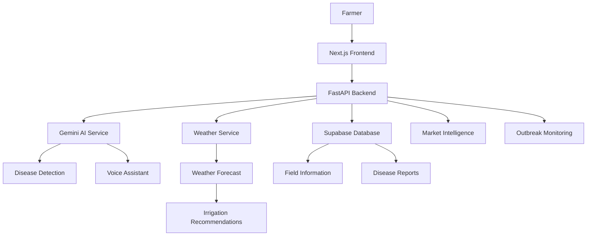
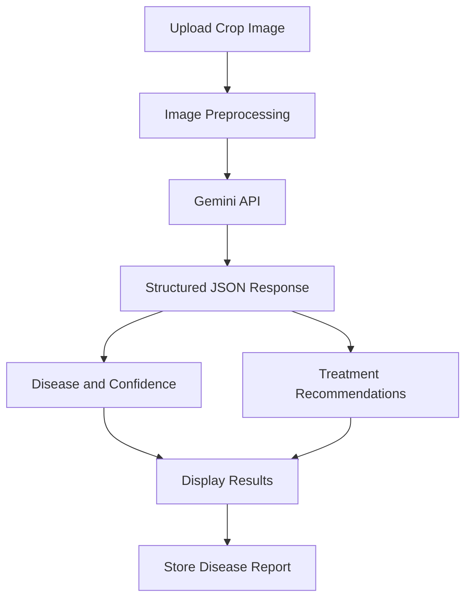

# KHETWISE

### An AI-powered agricultural intelligence platform for smarter, data-driven farming.

KHETWISE helps farmers make informed decisions through AI-assisted crop disease detection, weather-based irrigation recommendations, agricultural market insights, and regional disease outbreak monitoring.

The platform combines a Next.js frontend, FastAPI backend, Google Gemini, Supabase, and weather data to provide an integrated agricultural decision-support system.

---

## Overview

Agriculture involves decisions that directly affect crop health, water consumption, and farmer income. However, access to timely agricultural information and actionable recommendations remains a challenge.

KHETWISE addresses this by bringing multiple agricultural tools into a single platform, allowing farmers to monitor their fields, identify potential crop diseases, plan irrigation, and explore market information.

## Key Features

| Feature | Description |
|---|---|
| AI Disease Detection | Analyses crop images using Google Gemini to identify potential diseases and provide treatment recommendations. |
| Field Management | Allows farmers to register fields with crop, soil, location, and other agricultural details. |
| Irrigation Recommendations | Uses weather forecasts and reference evapotranspiration data to generate irrigation guidance. |
| Market Intelligence | Provides indicative crop prices, market comparisons, and estimated transportation considerations. |
| Disease Outbreak Monitoring | Displays reported disease cases geographically and identifies nearby outbreak risks. |
| Voice Assistant | Enables farmers to interact with the platform through voice-based queries. |
| Multilingual Interface | Supports English, Hindi, Telugu, Tamil, Bengali, and Marathi. |
| Field Health Dashboard | Presents field information, health indicators, and historical demonstration data. |

## Application Screenshots

### Dashboard


### Disease Detection


### Irrigation Recommendations


### Disease Outbreak Monitoring


### Market Intelligence


---

## System Architecture

KHETWISE follows a client-server architecture. The frontend communicates with a FastAPI backend, which coordinates AI inference, weather data retrieval, and database operations.



### Technology Stack

| Layer | Technologies |
|---|---|
| Frontend | Next.js 14, React 18, TypeScript |
| Styling | Tailwind CSS |
| Backend | Python, FastAPI |
| AI Integration | Google Gemini API |
| Database | Supabase |
| Weather Data | Open-Meteo API |
| Maps | Leaflet, React Leaflet |
| Data Visualization | Recharts |
| Deployment | Vercel, Render |

## Technical Implementation

### 1. AI-Based Disease Detection

The disease detection workflow accepts crop images and processes them before sending them to the Gemini API.



Implementation details:

- Images are converted to RGB format using Pillow.
- Image dimensions are reduced to a maximum of 640 × 640 pixels.
- JPEG compression is applied before API submission.
- Gemini is instructed to return structured JSON containing disease information, confidence, and treatment recommendations.
- API errors, quota limitations, and invalid responses are handled through fallback logic.
- Non-healthy disease reports are stored in Supabase.

### 2. Weather-Based Irrigation

The irrigation module uses weather information and reference evapotranspiration to generate irrigation guidance.

The backend retrieves:

- Daily precipitation forecasts.
- Reference evapotranspiration (ET₀).
- Seven-day weather information.

The data is retrieved from Open-Meteo and processed to support irrigation recommendations.

### 3. Disease Outbreak Monitoring

The outbreak module uses geographical coordinates to identify reported disease cases near a farmer's location.

Implementation details:

- Uses the Haversine formula to calculate geographical distances.
- Considers reports from the previous 30 days.
- Uses a configurable monitoring radius, with a default of 100 km.
- Applies a 50 km proximity threshold for outbreak alerts.
- Displays reported cases through an interactive map.

### 4. Multilingual Voice Assistant

The voice assistant integrates browser-based speech capabilities with Gemini.

The workflow supports voice input, language-aware query processing, and generated responses. The frontend uses browser speech recognition and text-to-speech capabilities where supported.

### 5. Database Integration

Supabase is used for persistent storage of field information and disease reports.

The database schema includes:

- `users`
- `fields`
- `health_reports`
- `disease_reports`

The backend communicates with Supabase using server-side credentials.

---

## Project Structure

```text
KHETWISE/
│
├── backend/
│   ├── main.py
│   ├── requirements.txt
│   ├── seed.py
│   │
│   ├── db/
│   │   └── supabase_client.py
│   │
│   ├── routes/
│   │   ├── field.py
│   │   ├── disease.py
│   │   ├── health.py
│   │   ├── irrigation.py
│   │   ├── market.py
│   │   ├── voice.py
│   │   └── outbreaks.py
│   │
│   └── services/
│       ├── gemini.py
│       └── weather.py
│
├── frontend/
│   ├── app/
│   │   ├── dashboard/
│   │   ├── disease/
│   │   ├── field/
│   │   ├── irrigation/
│   │   ├── market/
│   │   ├── onboarding/
│   │   └── outbreaks/
│   │
│   ├── components/
│   │   ├── GlossaryTooltip.tsx
│   │   ├── HealthCard.tsx
│   │   ├── IrrigationSchedule.tsx
│   │   ├── NDVIChart.tsx
│   │   ├── Nav.tsx
│   │   ├── OutbreakMap.tsx
│   │   ├── StressAlert.tsx
│   │   └── VoiceBox.tsx
│   │
│   ├── lib/
│   │   ├── crops-data.ts
│   │   ├── glossary.ts
│   │   ├── i18n.ts
│   │   ├── onboarding-store.ts
│   │   └── utils.ts
│   │
│   └── services/
│       ├── api.ts
│       └── mock.ts
│
├── docs/
│   └── supabase_schema.sql
│
├── render.yaml
├── LICENSE
└── README.md
```

---

## Getting Started

### Prerequisites

Ensure the following are installed:

- Node.js 18 or later
- Python 3.11 or later
- npm
- Git
- A Supabase project
- A Google Gemini API key

### 1. Clone the Repository

```bash
git clone https://github.com/TheDeductor/KHETWISE.git

cd KHETWISE
```

### 2. Configure Supabase

1. Create a Supabase project.
2. Open the SQL Editor.
3. Execute the schema available at `docs/supabase_schema.sql`.
4. Obtain the project URL and service role key from your Supabase project settings.

### 3. Configure the Backend

Navigate to the backend directory:

```bash
cd backend
```

Create a `.env` file:

```env
GEMINI_API_KEY=your_gemini_api_key
GEMINI_MODEL=gemini-2.5-flash

SUPABASE_URL=your_supabase_url
SUPABASE_SERVICE_ROLE_KEY=your_supabase_service_role_key
```

Create and activate a virtual environment.

**Windows:**

```powershell
python -m venv venv
venv\Scripts\activate
```

**Linux/macOS:**

```bash
python -m venv venv
source venv/bin/activate
```

Install dependencies:

```bash
pip install -r requirements.txt
```

Start the backend server:

```bash
uvicorn main:app --reload
```

The backend will be available at:

```text
http://localhost:8000
```

API documentation:

```text
http://localhost:8000/docs
```

### 4. Configure the Frontend

Open a separate terminal:

```bash
cd frontend
```

Create a `.env.local` file:

```env
NEXT_PUBLIC_API_URL=http://localhost:8000
```

Install dependencies:

```bash
npm install
```

Start the development server:

```bash
npm run dev
```

The frontend will be available at:

```text
http://localhost:3000
```

---

## API Reference

The backend exposes the following endpoints:

| Method | Endpoint | Description |
|---|---|---|
| POST | `/api/field/register` | Register a new field |
| GET | `/api/field/{field_id}` | Retrieve field information |
| POST | `/api/disease/predict` | Analyse a crop image |
| GET | `/api/health` | Retrieve field health information |
| GET | `/api/ndvi-history` | Retrieve NDVI history data |
| GET | `/api/irrigation` | Retrieve irrigation recommendations |
| GET | `/api/market` | Retrieve market information |
| POST | `/api/voice/query` | Process a voice assistant query |
| GET | `/api/outbreaks` | Retrieve disease outbreak information |

Interactive API documentation is available through FastAPI Swagger UI at `/docs`.

---

## Current Limitations

The following limitations are important when interpreting the application's output:

- **NDVI and field health:** Currently uses demonstration data; live satellite imagery integration is not implemented.
- **Market intelligence:** Uses predefined market data rather than a live mandi price feed.
- **Irrigation:** Recommendations are estimates based on available weather and evapotranspiration inputs, not guaranteed water requirements.
- **Authentication:** A complete user authentication and authorization system is not yet implemented.
- **Outbreak reporting:** The reporting interface is not fully connected to backend report submission.
- **Database policies:** Production-grade Row Level Security policies should be configured before handling real user data.
- **Voice support:** Browser speech recognition and speech synthesis depend on browser capabilities and permissions.
- **AI recommendations:** Disease identification and treatment suggestions should be verified with qualified agricultural experts before application.

---

## Future Scope

Potential improvements include:

- Integration with live satellite imagery for real-time crop health monitoring.
- Live agricultural market price feeds.
- More comprehensive crop disease datasets and validation.
- User authentication and role-based access control.
- Automated disease outbreak reporting and notification workflows.
- More advanced irrigation models using soil moisture and crop growth stages.
- Offline support for areas with limited internet connectivity.
- Expanded regional language and voice support.


## License

This project is licensed under the MIT License. See the [LICENSE](LICENSE) file for details.

---

**KHETWISE** — Bringing agricultural intelligence and data-driven decision-making together.
